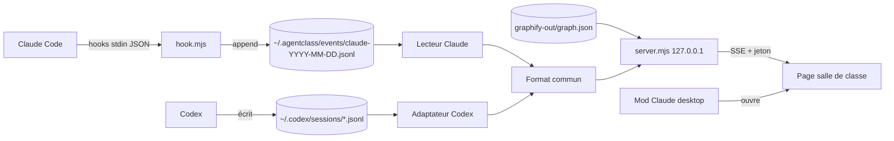

# TRD : AgentClass
Date : 2026-10-20 · Statut : brouillon

## Stack
| Couche | Choix | Pourquoi |
|---|---|---|
| Interface | HTML, CSS et JS sans framework, sans build | Une seule page, plugin léger, rien à compiler |
| Graphe du tableau | Rendu SVG ou canvas maison ; une petite lib seulement si elle est nécessaire (à décider au lot 3) | Peu de dépendances |
| Langage | JavaScript ES modules, typé avec JSDoc, vérifié par `tsc --checkJs` sans émission | Contrôle des types sans étape de build |
| Serveur | Node.js (LTS), modules natifs `http`, `fs`, `crypto` | Aucune dépendance au runtime |
| Temps réel | SSE (`text/event-stream`) | Natif dans les navigateurs, sens unique suffisant |
| Données | Fichiers JSONL locaux dans `~/.agentclass/` | Écriture en append, simple, sans base |
| Authentification | Aucun compte. Jeton aléatoire créé une fois, gardé dans `~/.agentclass/config.json` (droits utilisateur seulement), pour un lien stable | Protège le port local des autres pages web |
| Hébergement | Local seulement (127.0.0.1) | 0 token, rien en ligne |

## Architecture


Règles :
- `hook.mjs` ne fait qu'une chose : lire stdin, réduire le contenu, ajouter une ligne, sortir en 0. Il n'écrit jamais de texte brut sur stdout ni d'`additionalContext`, parce que ce texte serait injecté dans le contexte et coûterait des tokens. Seule exception, au SessionStart : il lance le serveur s'il ne tourne pas (processus détaché) et écrit un JSON `{ systemMessage }` avec le lien de la salle, affiché à l'utilisateur et jamais envoyé au modèle (`claude plugin details` confirme ~0 token). Toute erreur est avalée.
- Installation locale : `.claude-plugin/marketplace.json` à la racine du dépôt. `claude plugin marketplace add <dossier>` puis `claude plugin install agentclass@agentclass`. Après une modification : monter la version, puis `npm run plugin:update`.
- Chaque source a son lecteur, isolé, qui produit le format commun (voir 05-SCHEMA).
- Le serveur suit les fichiers (`fs.watch` plus lecture depuis le dernier offset) et diffuse en SSE.

## API et services externes
| Service | Usage | Limites |
|---|---|---|
| Aucun | | 0 appel réseau sortant |

Points de contact locaux : la configuration des hooks de Claude Code (manifeste du plugin), `~/.claude/agents/*.md` et les agents des plugins pour les chaises, `~/.codex/sessions/` et `graphify-out/graph.json`.

## Routes du serveur
| Route | Rôle |
|---|---|
| `GET /?t=<jeton>` | Page de la salle |
| `GET /web/<fichier>` | Fichiers statiques de la page (sans jeton : rien de secret ; Host et Origin vérifiés) |
| `GET /events?t=<jeton>` | Flux SSE |
| `GET /api/agents?t=<jeton>` | Liste des agents connus |
| `GET /api/graph?t=<jeton>&project=<id>` | Graphe réduit (nœuds, liens) |
| `POST /shutdown?t=<jeton>` | Arrêt propre |

Chaque requête vérifie `Host` (`127.0.0.1:<port>` ou `localhost:<port>`) et `Origin` (absent ou même origine). Pas d'en-tête CORS. Réponse 403 sinon. En-têtes : CSP stricte (`frame-ancestors 'none'`), `nosniff`, `no-referrer`.
- Verrou contre le double démarrage : `server.json` créé en exclusif (`wx`) ; un PID mort rend le fichier caduc.
- `fs.watch` plus balayage d'appoint d'une seconde : sous Windows, le chemin est résolu en nom long avant de surveiller (crash libuv sur un nom court 8.3).

## Temps réel, hors ligne, performances
- Événement visible sur la page en moins d'une seconde.
- Latence du hook à mesurer au lot 0 sous Windows. Si le démarrage de Node par appel d'outil coûte trop cher, plan B à étudier : hook en commande native du shell, ou envoi vers le serveur déjà lancé.
- Graphes de quelques milliers de nœuds : le serveur envoie une version réduite (id, label, chemin, liens).
- Purge des fichiers d'événements de plus de 7 jours au démarrage du serveur.

## Variables d'environnement
| Nom | Rôle | Où la trouver |
|---|---|---|
| `AGENTCLASS_PORT` | Port du serveur (défaut 47100, les 9 suivants en repli si occupé ; la démo prend +10) | facultatif |
| `AGENTCLASS_HOME` | Dossier des données (défaut `~/.agentclass`) | facultatif |
| `AGENTCLASS_OFF` | Désactive le hook sans le désinstaller | facultatif |

## Structure du dépôt
```
AgentClass/
  .claude-plugin/plugin.json    manifeste du plugin et des hooks
  bin/agentclass.mjs            CLI : start, stop, demo, codex, uninstall
  hooks/hook.mjs                hook ultra court
  server/server.mjs             HTTP, SSE, sécurité, cycle de vie
  server/readers/claude.mjs     JSONL Claude vers format commun
  server/readers/codex.mjs      JSONL Codex vers format commun
  server/graph.mjs              lecture et réduction de graph.json
  server/demo.mjs               événements factices
  web/index.html, app.js, style.css, i18n/fr.json, i18n/en.json
  mod/                          intégration Claude desktop (lot 7)
  test/fixtures/                vrais événements capturés, versionnés
  test/*.test.mjs               node:test
  docs/
```

## Tests et qualité
- `node --test` : tests de contrat des lecteurs sur des fixtures réelles versionnées, tests du hook (sortie toujours en 0, rien sur stdout, réduction des données), tests de sécurité du serveur (Host, Origin, jeton).
- `tsc --noEmit --checkJs` pour les types JSDoc.
- Lint : ESLint, configuration minimale.
- Test manuel de la page avec `--demo` et avec une vraie session.
- Audit : `npm audit`. Aucune dépendance au runtime visée.

## Déploiement
- Dépôt GitHub public, branche `main`, tag `v0.x-alpha`.
- Lot 6 : publication dans une marketplace de plugins Claude et sur npm. Pas de script `postinstall`, provenance npm activée.

## Risques techniques
| Risque | Parade |
|---|---|
| Les hooks ne fournissent pas `tool_use_id` ni l'identifiant du sous-agent | Vérifié au lot 0. Sinon, appariement par ordre et par outil, et moins de promesses. |
| Hook lent ou qui plante | Code minimal, try/catch global, exit 0, mesure de la latence |
| Écritures concurrentes sous Windows | Un fichier par jour, une ligne par `appendFileSync`, une ligne courte |
| Formats Claude, Codex ou Graphify qui changent | Lecteurs isolés, tests de contrat, version du format dans chaque ligne |
| Serveur zombie ou en double | Fichier PID, verrou, port de repli, arrêt quand plus aucune session n'est active depuis X minutes |
| Lecture du flux par une autre page web | Jeton, Host et Origin vérifiés, pas de CORS |
| Mod Claude desktop impossible | Repli : commande `/agentclass` qui ouvre la page |

## Rapport du lot 0
- Latence du hook sous Windows 11, Node 24 (`npm run bench:hook`, 50 appels) : médiane 55 ms, p90 59 ms. Soit environ 110 ms par outil (PreToolUse et PostToolUse). Jugé acceptable : pas de plan B pour l'instant.
- Capture réelle (session avec 2 sous-agents Explore en parallèle, extrait anonymisé dans `test/fixtures/claude-two-subagents.jsonl`) :
  - Tous les événements : `session_id`, `cwd`, `transcript_path`, `prompt_id`, `hook_event_name`.
  - Dans un sous-agent, chaque appel d'outil porte `agent_id` et `agent_type`. Deux sous-agents en parallèle se distinguent sans ambiguïté.
  - `tool_use_id` présent sur PreToolUse et PostToolUse ; `duration_ms` sur PostToolUse.
  - Un outil en échec n'émet pas PostToolUse mais `PostToolUseFailure` : hook ajouté, sinon l'aller resterait sans retour.
  - L'appel `Agent` du principal n'est pas relié par un identifiant au `SubagentStart` qui suit : liaison par ordre et par heure si besoin.
- Décision : appariement par `tool_use_id` (champ `call`). Expiration des allers sans retour gardée par sécurité (outil interrompu).
- Le champ temporaire `keys` est retiré du hook.

## Questions ouvertes
- Délai d'arrêt automatique du serveur.
- Lib de graphe ou rendu maison (lot 3).
- Plan B pour la latence du hook, si besoin.
