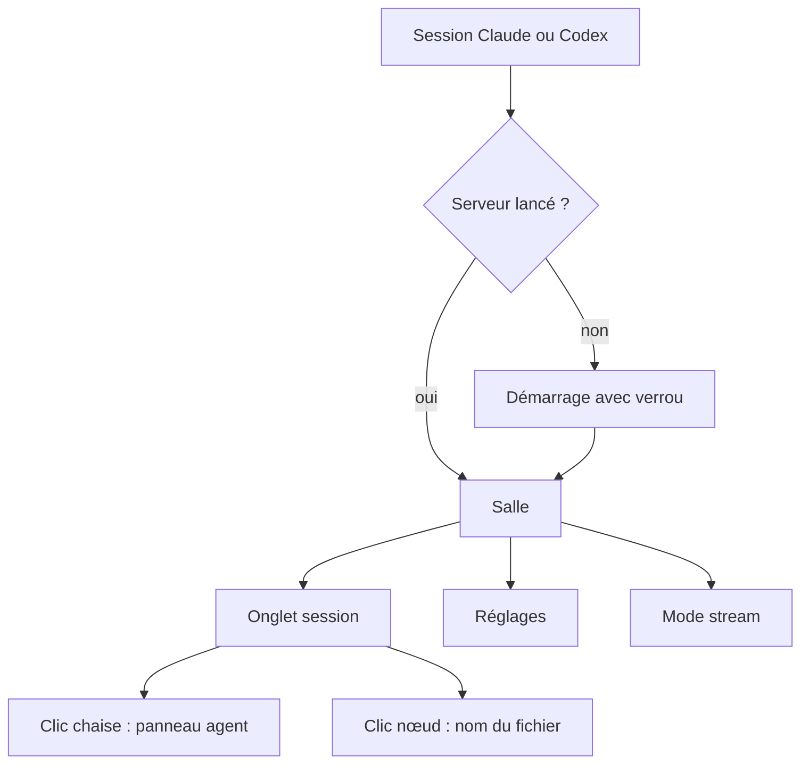

# App flow : AgentClass
Date : 2026-10-20 · Statut : brouillon

## Écrans
| Écran | Route ou nom | Rôle de l'écran | Qui y accède |
|---|---|---|---|
| Salle de classe | `/?t=<jeton>` | Vue en direct d'une session | L'utilisateur local |
| Panneau agent | superposé à la salle | Détails de l'agent cliqué | idem |
| Panneau réglages | superposé à la salle | Thème, langue, vitesse, mode stream | idem |

Une seule page. Les panneaux sont des tiroirs latéraux, pas des pages.

## Navigation
- En haut : onglets des sessions (une salle par session ; nom du projet, logo de l'IA, pastille d'activité).
- En haut à droite : bascule FR/EN, bascule du mode stream, bouton des réglages.
- Entrées : icône dans Claude desktop (lot 7), commande `agentclass start` ou `/agentclass`, lien affiché au démarrage du serveur.

## Parcours principal
1. L'utilisateur lance une session Claude Code. Le hook SessionStart démarre le serveur s'il ne tourne pas déjà.
2. Il ouvre la salle (icône, commande ou lien). La page affiche l'onglet de la session en cours.
3. L'IA lit un fichier. Un point rouge part du nœud « IA » vers le fichier sur le tableau, puis revient en vert au résultat.
4. L'IA lance un sous-agent. Sa chaise s'allume, sa durée défile, puis la chaise s'éteint à la fin.
5. Une deuxième session démarre : un nouvel onglet apparaît.

## Autres parcours
- Mode démo : `agentclass demo` ouvre la salle avec des événements factices.
- Codex : `npx agentclass codex` lance le serveur avec l'adaptateur Codex.
- Désinstallation : `agentclass uninstall` arrête le serveur, retire nos hooks et propose de supprimer `~/.agentclass`.
- Aucune inscription ni connexion.

## Actions clés
| Écran | Action | Résultat | Écran suivant |
|---|---|---|---|
| Salle | Clic sur une chaise | Panneau : nom, description, état, durée, dernier outil | Panneau agent |
| Salle | Clic sur un nœud ou un fichier du tableau | Infobulle avec le nom du fichier (chemin masqué en mode stream) | Salle |
| Salle | Clic sur un onglet | Bascule vers la salle de cette session | Salle |
| Salle | Bascule du mode stream | Chemins masqués partout | Salle |
| Réglages | Thème, langue, vitesse | Appliqué tout de suite, mémorisé en localStorage | Salle |

## États
| Écran | Vide | Chargement | Erreur |
|---|---|---|---|
| Salle sans session | Prof endormi, « En attente de l'IA », une ligne d'aide | Squelette de la salle | Serveur injoignable : bannière « Connexion perdue, nouvel essai… » et reconnexion SSE automatique |
| Tableau sans graphe | Liste des fichiers touchés, plus « Pas encore de graphe, lance `/graphify` » | — | `graph.json` illisible : liste des fichiers, plus un message |
| Fichier hors du graphe | Le point va vers une zone « hors graphe » du tableau | — | — |
| Agent sans description | Nom seul | — | — |
| Jeton absent ou faux | — | — | Page 403 qui explique comment rouvrir le bon lien |

## Rôles et droits d'affichage
Aucun : un seul utilisateur local.

## Notifications
Aucune hors de la page. Dans la page, un badge d'alerte de boucle sur la chaise concernée.

## Diagramme

## Questions ouvertes
- Ordre des onglets (session la plus récente en premier ?).
- Faut-il garder l'onglet d'une session terminée, et combien de temps ?
