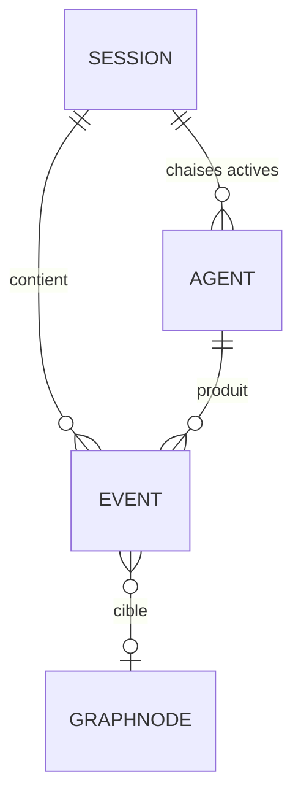

# Schéma des données : AgentClass
Date : 2026-10-20 · Statut : brouillon

## Stockage
- `~/.agentclass/events/claude-YYYY-MM-DD.jsonl` : une ligne par événement Claude, en append seul.
- `~/.agentclass/server.json` : port, PID, jeton, heure de démarrage. Lisible par l'utilisateur seulement.
- Codex : rien n'est copié. L'adaptateur lit `~/.codex/sessions/` directement.
- Navigateur : `localStorage` pour les préférences (thème, langue, vitesse, mode stream).
- Mémoire du serveur : état courant des sessions et des agents, reconstruit au démarrage depuis les fichiers du jour.

Pourquoi : local, sans base, facile à purger et à inspecter.

## Entités

### Event (format commun, une ligne JSONL)
| Champ | Type | Contraintes | Description |
|---|---|---|---|
| v | number | obligatoire | Version du format (1) |
| ts | string | ISO 8601 | Horodatage |
| source | `"claude"` \| `"codex"` | obligatoire | IA d'origine |
| session | string | obligatoire | Identifiant de session |
| agent | string | défaut `"main"` | Identifiant de l'agent ou du sous-agent |
| kind | `"session_start"` \| `"agent_start"` \| `"agent_stop"` \| `"tool_call"` \| `"tool_result"` | obligatoire | Type d'événement |
| call | string | facultatif | Identifiant d'appariement de l'aller et du retour (`tool_use_id` s'il existe) |
| tool | string | facultatif | `Read`, `Grep`, `Bash`… |
| target | string | facultatif | Chemin relatif au projet, 200 caractères au plus. Pas de contenu. |
| project | string | facultatif | Dossier de travail (`cwd`) |
| ok | boolean | sur `tool_result` | Succès ou échec |
| agentType | string | facultatif | Type du sous-agent (`Explore`…), s'il est fourni |
| ms | number | facultatif, sur `tool_result` | Durée de l'outil (`duration_ms`) |

Jamais stockés : le texte des prompts, le contenu des fichiers, la sortie des outils, les arguments complets de `Bash`. Pour `Bash`, seul le motif `graphify query` est reconnu ; sa question n'est pas stockée.

### Agent
| Champ | Type | Contraintes | Description |
|---|---|---|---|
| id | string | clé | Nom de l'agent (`subagent_type` ou nom du fichier) |
| label | string | | Nom affiché |
| description | string | 160 caractères au plus | Tiré du front matter de l'agent |
| origin | `"user"` \| `"plugin"` \| `"seen"` | | `~/.claude/agents`, agent d'un plugin, ou vu seulement dans les événements |

### Session (en mémoire)
| Champ | Type | Description |
|---|---|---|
| id | string | Identifiant de session |
| source | string | IA d'origine |
| project | string | Dossier |
| startedAt / lastAt | string | Début et dernière activité |
| active | map agent → depuis | Agents actifs |
| pending | map call → Event | Allers sans retour |
| reads | map target → nombre | Compteur pour l'alerte de boucle |

### GraphNode (lu depuis `graph.json`, réduit)
| Champ | Type | Description |
|---|---|---|
| id | string | Identifiant du nœud |
| label | string | Nom affiché |
| path | string | Chemin du fichier, s'il existe, pour la correspondance |
| links | string[] | Nœuds voisins |

## Relations

## Droits d'accès
| Entité | Lire | Créer | Modifier | Supprimer |
|---|---|---|---|---|
| Event | serveur, page avec jeton | hook, adaptateurs | personne | purge automatique au-delà de 7 jours, désinstallation |
| Agent | serveur, page avec jeton | serveur (lecture des définitions) | personne | — |
| server.json | CLI, hook | serveur | serveur | serveur à l'arrêt |

## Authentification
Pas de compte. Le serveur génère un jeton aléatoire de 32 octets (`crypto.randomBytes`) à chaque démarrage. Il l'écrit dans `server.json` et l'ajoute au lien d'ouverture. Requête sans jeton valide : 403.

## Données personnelles
- Aucune donnée ne quitte la machine.
- Stockés : des chemins relatifs de fichiers et des noms d'outils. Durée : 7 jours, puis purge.
- Mode stream : la page ne montre que le nom du fichier, ou un alias.
- `agentclass uninstall` propose de supprimer `~/.agentclass`.

## Fichiers envoyés
Aucun.

## Migrations et reprise de données
Le champ `v` versionne le format. Un lecteur ignore les lignes d'une version inconnue sans planter.

## Sauvegarde et export
Aucune sauvegarde. Le JSONL est lisible tel quel.

## Questions ouvertes
- Structure exacte des JSONL de Codex : à vérifier au lot 8.
- Clé de correspondance entre un nœud Graphify et un fichier : à vérifier sur un vrai `graph.json` au lot 3.
